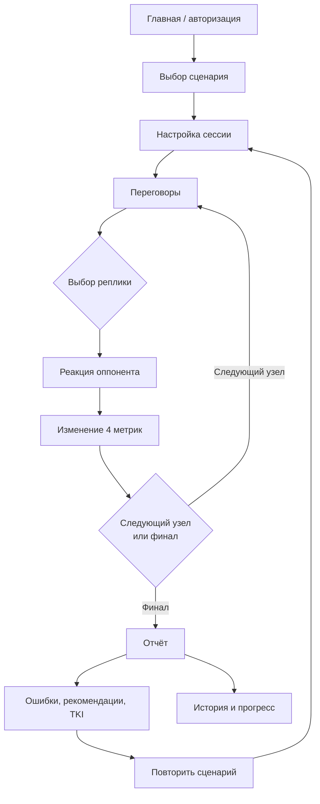

# MVP-карта проекта «Арена переговоров»

## 1. Суть MVP

**«Арена переговоров»** — офлайн-тренажёр деловых переговоров. Пользователь проходит сценарий, выбирает реплики и тактики, видит реакцию собеседника и получает понятный разбор результата.

**Ценность для пользователя:** безопасно потренировать сложный разговор до реальной встречи и понять, какие решения помогли или помешали договориться.

**Ключевой принцип:** офлайн-сценарий полностью работает без API-ключей, интернета и LLM. Нейросеть может расширять диалог в следующих версиях, но не является источником финального результата.

## 2. Карта продукта



## 3. Что входит в MVP

| Блок | Что делает пользователь | Результат |
| --- | --- | --- |
| Вход | Открывает сайт, регистрируется или входит в аккаунт | Получает личный кабинет и сохранение истории |
| Выбор кейса | Выбирает один из трёх сценариев: увольнение, переговоры о зарплате или торг за скидку | Начинает тренировку в понятном бизнес-контексте |
| Настройка | Выбирает пресет, цель и дополнительные условия | Сессия адаптируется под задачу |
| Переговоры | Выбирает реплики и тактики в диалоге | Сценарий реально ветвится, а не идёт по одной линии |
| Метрики | Наблюдает за доверием, достижением цели, контролем и EQ | Видит последствия решений во время разговора |
| Финал | Получает один из разных исходов | Понимает, удалось ли договориться и какой ценой |
| Отчёт | Изучает график, ошибки, альтернативы и рекомендации | Может закрепить сильные решения и исправить слабые |
| Повтор | Переигрывает сценарий с другой стратегией | Сравнивает подходы на практике |
| История | Открывает прошлые сессии и отчёты | Отслеживает личный прогресс |
| Администрирование | Редактирует контекст сценария через админ-панель | Меняет бриф без изменения кода и JSON |

## 4. Ядро игрового цикла

```text
Выбрать деловую ситуацию
        ↓
Сформулировать переговорную цель
        ↓
Выбрать действие или реплику
        ↓
Получить реакцию собеседника
        ↓
Увидеть изменение метрик
        ↓
Скорректировать тактику
        ↓
Получить итог и персональный разбор
        ↓
Повторить и улучшить результат
```

## 5. Ветвления MVP

### Ветка выбора стратегии

| Поведение пользователя | Что происходит в диалоге |
| --- | --- |
| Слушает, задаёт вопросы, признаёт интересы собеседника | Растёт доверие, открывается путь к сотрудничеству |
| Предлагает объективные критерии, BATNA или обмен уступками | Растёт вероятность выгодной договорённости |
| Давит, перебивает или использует ультиматумы | Снижается доверие, собеседник занимает оборону |
| Уступает без встречных условий | Может сохранить отношения, но теряет цель и контроль |
| Игнорирует эмоции и возражения | Диалог уходит в напряжение или конфликт |

### Ветка результата

```text
Высокая цель + высокое доверие  → успешная договорённость
Цель достигнута, доверие ниже   → результат есть, но отношения напряжены
Средние показатели              → частичный компромисс
Низкий контроль или доверие     → конфликт / разрыв переговоров
Низкое достижение цели          → провал переговоров
```

### Ветка после финала

```text
Отчёт
 ├── посмотреть ошибки и альтернативные реплики
 ├── изучить рекомендации
 ├── открыть идеальный ход диалога
 ├── переиграть сценарий
 └── сохранить результат в историю
```

## 6. Метрики и объяснимость

Система не выдаёт непрозрачную оценку. Каждое действие меняет четыре ограниченные шкалы от 0 до 100:

- **Доверие** — готовность собеседника к открытому и конструктивному разговору.
- **Цель** — насколько пользователь приблизился к своей переговорной задаче.
- **Контроль** — способность удерживать структуру и направление диалога.
- **EQ** — качество работы с эмоциями, сигналами и состоянием второй стороны.

В отчёте отображается также **Confidence**: взвешенный показатель, построенный на цели, доверии и контроле. Метрики описывают поведение в конкретной сессии, а не оценивают личность пользователя.

## 7. Сценарии первой версии

1. **Увольнение без конфликта** — разговор руководителя с сотрудником в сложной HR-ситуации.
2. **Переговоры о зарплате** — поиск решения между ожиданиями сотрудника и ограничениями компании.
3. **Торг за скидку** — работа с требованием клиента снизить цену без потери ценности сделки.

Во всех кейсах есть несколько вариантов реплик, реакций оппонента и разные финалы: успех, компромисс, частичный результат, напряжение, конфликт или провал.

## 8. Границы MVP

### Обязательно показать на демо

- офлайн-сценарий без ключей и внешних сервисов;
- минимум три полных деловых кейса;
- реальные ветвления после решений пользователя;
- четыре живые метрики;
- разные окончания переговоров;
- подробный отчёт и повтор прохождения;
- история сессий и админ-настройка сценарного контекста;
- воспроизводимый запуск и тесты.

### Усиления после MVP

- свободный диалог с GigaChat и резервным Ollama;
- голосовой ввод и озвучивание;
- Ghost Coach с короткими тактическими подсказками;
- расширенная программа обучения, уровни и достижения;
- комнаты 1×1, приглашения и корпоративная аналитика.

### Не включать в MVP

- рейтинговый PvP;
- пользовательские сценарии без модерации;
- сложную экономику звёзд и косметики;
- ежедневные челленджи как обязательное ядро;
- психометрические выводы о личности пользователя.

## 9. Формулировка для защиты

> «Мы не сделали чат с нейросетью. Мы сделали объяснимый тренажёр переговорных решений: пользователь выбирает тактику, видит последствия для доверия, цели, контроля и эмоционального интеллекта, получает разбор и может сразу переиграть сложный момент. Главное — продукт работает офлайн, поэтому демонстрация и практика не зависят от ключей и внешних сервисов.»
